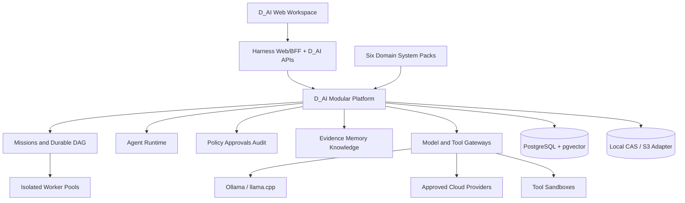

# التصور المعماري المقترح لـD_AI

## الحالة

هذه معمارية مرشحة مبنية على مراجعة المصدر المثبت، وليست ADR نهائيًا. يثبت M1 أو يعدل كل قرار يتصل بسلوك Harness الفعلي. المرجع الحالي يؤكد أن Harness يستخدم Cordis ومعمارية all-plugin، وأن الإطلاق المدعوم يمر عبر profiles، لذلك يكون D_AI تركيبًا أصليًا جديدًا مع أقل core delta ممكن.

## البنية العليا



التوصية هي Modular Monolith مع processes منفصلة للworkers والأدوات والنماذج. تبقى الوحدات ذات APIs وأحداث وجداول مملوكة، لكن لا تضاف شبكة microservices قبل الحاجة. هذا يناسب التشغيل المحلي و16GB RAM ويترك منافذ للفصل المؤسسي لاحقًا.

## العلاقة مع Harness

### ما يعاد استخدامه

| حاجة D_AI | مكوّن Harness المرشح | ملاحظة Phase 0 |
|---|---|---|
| تشغيل الوكيل ودورته | `core/agent`, `core/agent-loop` | يجب تحديد extension events الكافية قبل core patch |
| التاريخ model-visible | `core/session` وsession persistence/projections | يبقى كل إدخال يصل للنموذج قابلًا لإعادة البناء من Session log |
| الأدوات | `core/tools` ومجموعات shell/web/fs/MCP | يضاف D_AI Tool Gateway enforcement حول/داخل المسار الموثق |
| وكلاء فرعيون | `subagent` و`experimental/agent-team` | Agent Team حاليًا process-local وفريق مسطح؛ لا يحقق كل hierarchy المطلوبة |
| jobs/workflows | `jobs`, `workflow`, `schedule` | تراجع الديمومة والleases وDAG قبل تقرير reuse أو extension |
| التخزين | `storage-*`, `session-persistence-*` | لا يفترض أنه يكفي للgraph/audit/queue دون قياس |
| الموافقة والصلاحية | `authorization`, `user-approval`, `permission-presets` | تحتاج توسعة إلى ABAC وapproval binding وrevocation |
| العزل | `sandbox-*`, `subprocess-*`, `fs-*` | يحتاج threat testing وnetwork policy للأدوات عالية الأثر |
| مساحات العمل | `workspace`, `attachment`, `deliverables` | يضاف organization/classification/mission scope |
| الواجهة | `web-app`, `client/*`, UI slots/modules | تبنى شاشات D_AI كتسجيلات أصلية، لا SPA جانبي منفصل |
| النماذج | `llm/*`, credentials, model selection | يضاف registry/router مع privacy/cost/eval policy |
| المراقبة | session/product OpenTelemetry packages | يمنع محتوى حساس ويضاف correlation للمهمة/الوكيل/الأداة |

### فصل مصادر الحقيقة

يقترح ADR مبكر القاعدة التالية:

- Harness Session log هو المصدر للturns والرسائل وtool events والمحتوى model-visible.
- D_AI operational event store هو المصدر للمهمات والخطط والـDAG والسياسات والموافقات والميزانيات والأدلة وعقود الأنظمة.
- لا يُخزن نفس القرار كحقيقتين قابلتين للاختلاف. الربط يستخدم IDs ثابتة وoutbox/idempotent projections.
- أي D_AI context يصل إلى model يسجل أيضًا كSession event أو reference قابل للحل وفق عقد Harness.

إذا أثبت M1 أن Harness domain storage/session events تستطيع امتلاك جزء من الحالة دون ازدواج، يُعدل التقسيم عبر ADR قبل schema implementation.

## الوحدات ومسؤولياتها

### Kernel

يملك branded IDs، actor context، classification، money/token/resource units، event envelope، error model، time source، feature maturity. لا يملك منطق مجال أو provider.

### Identity and Workspace

يملك organizations, actors, memberships, workspaces, projects والجلسات البشرية/service identities. يحمل كل record تشغيلي `organization_id` و`workspace_id`، ويُفرض العزل في storage/API/search/queue/cache وليس filter واجهة فقط.

### System Registry

يملك manifests وإصداراتها والتوافق والتفعيل. كل manifest يعلن manager، workflows، tool profiles، policy bundle، memory scopes، artifacts/evidence types، eval suite، UI registrations، migrations، وعقود cross-system.

### Mission Director

يملك intake، scope، اختيار الأنظمة، plan versions، إعادة التخطيط، success criteria والحالة العليا. لا ينفذ الأدوات ولا يمنح الصلاحيات لنفسه.

### Agent Runtime

يملك agent definitions/instances/runs، parent-child relations، context snapshots، model/tool policy، performance observations وhandoffs. كل وكيل هو instance مستقلة بهوية وحالة وسياق، وليس role داخل prompt مشترك.

### Durable Scheduler

يملك tasks/dependencies/attempts/leases/checkpoints/wait conditions. التشغيل at-least-once مع `idempotency_key`, `lease_epoch`, transactional outbox وreconciliation. الـworker القديم لا يستطيع commit بعد fencing.

### Model Registry and Router

يملك provider/model/version/capabilities/context/privacy/region/cost/latency/evals. قرار route يسجل المدخلات والسبب والسياسة، وmanual override لا يمحو القرار الأصلي.

### Tool Gateway

كل أداة تعلن input/output schema، risk، side-effect class، targets، network/data egress، idempotency، cancellation، reconciliation، sandbox profile، artifacts/evidence. المسار المنطقي هو `validate → estimate → authorize → approve-if-needed → prepare → execute → checkpoint → reconcile → collect`.

### Policy, Approval and Audit

PDP يعيد `ALLOW`, `DENY`, أو `REQUIRE_APPROVAL` مع obligations. PEP يعيد التقييم عند tool execution، model egress، retrieval، artifact access، cross-system transfer، export وretry/resume. approval token يرتبط بـhash للaction/args/target/policy/cost ceiling/expiry؛ أي تغيير جوهري يبطله. audit append-only وtamper-evident مع hash chain/seals وفصل صلاحية auditor.

### Evidence and Knowledge

يملك sources، source versions، claims ونسخها، evidence links، observations، hypotheses، contradictions، verification runs، confidence assessments، entities والعلاقات. لا تعدل claim تاريخية؛ تنشأ نسخة superseding. الثقة تسجل basis وuncertainty وcalibration ونوع التحقق.

### Memory and Retrieval

يملك raw events، memory entries/scopes/links، embeddings وإسقاطات قابلة لإعادة البناء. كل نتيجة retrieval تحمل scope/classification/provenance وتدخل prompt كبيانات غير موثوقة.

### Artifact Store

يستخدم SHA-256 content-addressed storage للملفات immutable وmetadata/lineage في قاعدة البيانات. البداية filesystem محليًا، مع S3-compatible adapter للنشر الأكبر. Git لا يحمل artifacts التشغيلية.

### Budget and Resource Manager

يدعم reservations وusage للمبلغ والتوكنز والوقت وAPI calls وCPU/RAM/GPU والانتباه البشري. الحجز الذري يمنع تجاوز عدة workers للحد بالتوازي.

### Evaluation and Local Intelligence

يفصل data eligibility عن التشغيل. dataset builder لا يقرأ السجل الخام مباشرة؛ يأخذ records موافقًا عليها مع consent/license/classification. يحفظ snapshots وholdouts وexperiments/model lineage وpromotion/rollback.

### Domain System Packs

كل نظام يملك managers/workflows/policies/evals وامتدادات UI وأنواع artifacts المتخصصة. يستخدم mission/task/evidence/policy المشتركة ولا ينشئ بدائل لها.

## System Manifest المقترح

```yaml
id: investigation
version: 0.1.0
runtimeApi: 1
managerAgent: investigation-manager
workflows: []
toolProfiles: []
memoryScopes: []
artifactTypes: []
evidenceTypes: []
policyBundle: investigation-policy
evaluationSuite: investigation-v1
ui:
  routes: []
  slots: []
crossSystem:
  provides: []
  consumes: []
migrations: []
```

يخزن manifest hash والتوقيع/المالك، ولا يفعل إصدارًا غير متوافق مع runtime API أو migrations/evals المطلوبة.

## نموذج البيانات الأولي

| الوحدة | الكيانات الأساسية |
|---|---|
| الهوية | organizations, actors, memberships, workspaces, projects, classifications, grants |
| الأنظمة | system_definitions, versions, installations, workflows, agent_definitions, policy_bundles, feature_statuses |
| المهمات | missions, plan_versions, tasks, dependencies, attempts, leases, checkpoints, waits, human_tasks, outbox |
| الوكلاء والنماذج | agent_instances, relationships, runs, context_snapshots, handoffs, providers, models, routes, invocations |
| الأدوات | definitions, versions, installations, executions, execution_events, side_effect_records, sandbox_profiles, egress_rules |
| الأدلة | sources, claims, claim_versions, evidence_links, entities, relations, hypotheses, verifications, confidence |
| الذاكرة | raw_events, memory_entries, scopes, embeddings, projection_versions/checkpoints |
| التحكم | policies/versions, grants, approval_requests/decisions/tokens, audit_entries/seals |
| الموارد | budgets, reservations, usage, cost_rates, resource_samples |
| artifacts/ML | artifacts/versions/lineage, datasets/versions/members, eligibility, experiments, evaluations, model_lineage/promotions |

الأعمدة التي تدخل policy أو indexing تكون typed؛ يستخدم JSONB للmetadata المتغيرة فقط. لا يثبت مخطط فعلي قبل M1 وADRs الخاصة بالتخزين وsession integration.

## العقود الخارجية

تُفضل commands/queries versioned عبر REST أو آلية Harness المكافئة، وSSE cursor-based للأحداث، وWebSocket للterminal التفاعلي فقط. العمليات الحساسة تدعم idempotency وoptimistic concurrency.

Event envelope الأدنى يحمل `event_id`, `event_type`, `occurred_at`, `organization_id`, `workspace_id`, `mission_id`, actor, correlation/causation IDs, classification, schema version وpayload.

Cross-system call لا يمرر ذاكرة كاملة؛ يمرر references مصرحًا بها وcapability المطلوبة وgrants والتصنيف والميزانية والdeadline وpolicy/approval IDs، ثم result artifact/claim references والاستهلاك والحالة.

## حالات التشغيل

Mission state وTask state منفصلتان. يقترح للمهمة: `DRAFT, PLANNED, QUEUED, RUNNING, WAITING_FOR_HUMAN, BLOCKED_POLICY, BLOCKED_BUDGET, PAUSED, CANCELLING, CANCELLED, FAILED, COMPLETED`. وتقترح للمهمة الفرعية: `PENDING, READY, LEASED, RUNNING, WAITING_FOR_TOOL, WAITING_FOR_HUMAN, RETRY_WAIT, BLOCKED_POLICY, BLOCKED_BUDGET, SUCCEEDED, FAILED, CANCELLED`.

كل transition يمر عبر command transaction ويصدر event؛ الواجهة لا تكتب الحالة مباشرة.

## التخزين والنشر

الاختيار المرشح بعد M1 هو PostgreSQL 16+ كمصدر D_AI، `pgvector` للبحث الدلالي، FTS والـedge tables للرسم أولًا، وPostgreSQL leases للطابور. تستخدم local CAS للـartifacts. لا تضاف Redis/Kafka/Neo4j/OpenSearch/Temporal إلا بعد benchmark يثبت الحاجة.

على جهاز واحد: API/BFF process، scheduler وworker pools محدودة، PostgreSQL محلي، GPU queue بسعة 1، وتحميل نموذج محلي واحد مناسب للـ6GB VRAM. على خادم أقوى تفصل workers وinference nodes وS3 storage. النشر المؤسسي يضيف OIDC/KMS وHA وsearch/graph/workflow adapters عند الحاجة.

## قرارات ADR المطلوبة

1. Upstream/fork and update policy.
2. Harness integration and anti-corruption layer.
3. Modular monolith and worker boundaries.
4. Operational source of truth and PostgreSQL decision.
5. Event log and projections.
6. At-least-once, idempotency, fencing and reconciliation.
7. Artifact CAS and lineage.
8. System Manifest and runtime compatibility.
9. Policy PDP/PEP and approval binding.
10. Evidence versioning and provenance.
11. API/events transport.
12. Local/cloud model egress.
13. Relational graph first.
14. Tool isolation and supply chain.
15. Training data governance.
16. Arabic/English and bidi.
17. Audit tamper evidence.
18. Schema/event migration compatibility.

## قيود معمارية صريحة

- لا core patch قبل إثبات غياب extension point وتوثيق delta والاختبارات.
- لا وصول وحدة مباشرة إلى جداول وحدة أخرى؛ تستخدم commands/queries/events مملوكة.
- لا side effect دون سجل وحالة uncertain/reconcile عندما لا يمكن إثبات النتيجة.
- لا provider/model/tool باسم `latest` في تشغيل قابل لإعادة الإنتاج.
- لا downgrade تلقائي يفقد بيانات؛ يستخدم forward fix أو restore مدروس.
- historical time travel يعرض projection سابقة ولا يعيد تنفيذ side effects.
- reproducibility تعني تثبيت المدخلات والمصادر والإصدارات والparameters والنتائج؛ لا تعني حتمية LLM أو الويب الحي.
